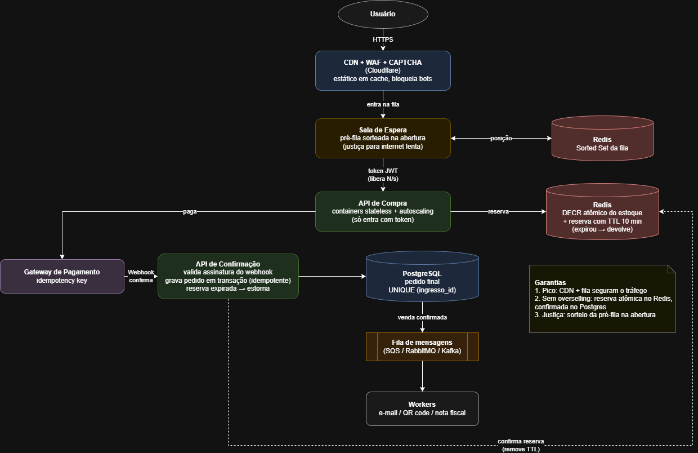

# Teste-BigDataCorp — Arquitetura de venda de ingressos

## Requisitos e como são atendidos

| Requisito | Solução |
|---|---|
| Aguentar acessos simultâneos | CDN absorve o pico; a sala de espera libera usuários no ritmo que o backend aguenta |
| Não vender sem ingresso disponível | Reserva atômica no Redis (`DECR`) antes do pagamento, confirmada no Postgres com `UNIQUE` |
| Internet lenta não perde a vez | Pré-fila sorteada na abertura: chegar milissegundos antes não dá vantagem |

## Fluxo

1. **CDN + WAF + CAPTCHA:** conteúdo estático em cache, rate limit por IP e bloqueio de bots.
2. **Sala de espera:** quem entra antes da abertura vai para uma pré-fila, sorteada na hora da venda; quem chega depois entra no fim da fila. A fila fica num Sorted Set do Redis.
3. **Liberação controlada:** a fila libera N usuários por segundo, cada um com um token JWT de validade curta.
4. **API de Compra:** stateless, com autoscaling, e só aceita requisições com token válido.
5. **Reserva:** `DECR` atômico no estoque do Redis. Se sobrou ingresso, cria uma reserva com TTL de 10 min; se a reserva expirar, o ingresso volta ao estoque.
6. **Pagamento:** gateway externo com idempotency key, para não cobrar duas vezes em caso de reenvio.
7. **API de Confirmação:** recebe o webhook, valida a assinatura, grava o pedido no Postgres em transação idempotente e confirma a reserva no Redis (remove o TTL). Pagamento aprovado depois que a reserva expirou é estornado.
8. **PostgreSQL:** fonte da verdade; `UNIQUE (ingresso_id)` impede venda duplicada mesmo se outra camada falhar.
9. **Fila de mensagens + Workers:** e-mail, QR code e nota fiscal são processados de forma assíncrona, fora do caminho crítico da compra.
